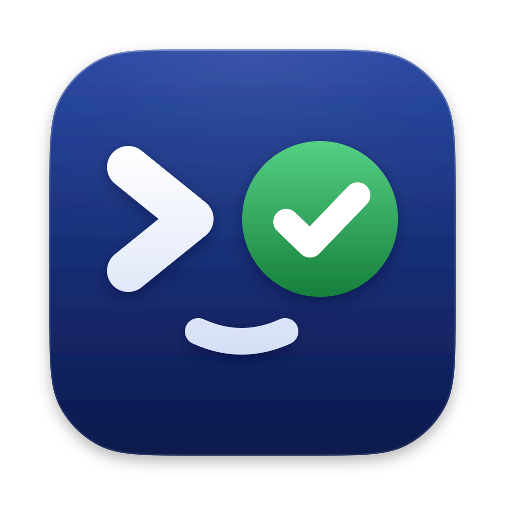
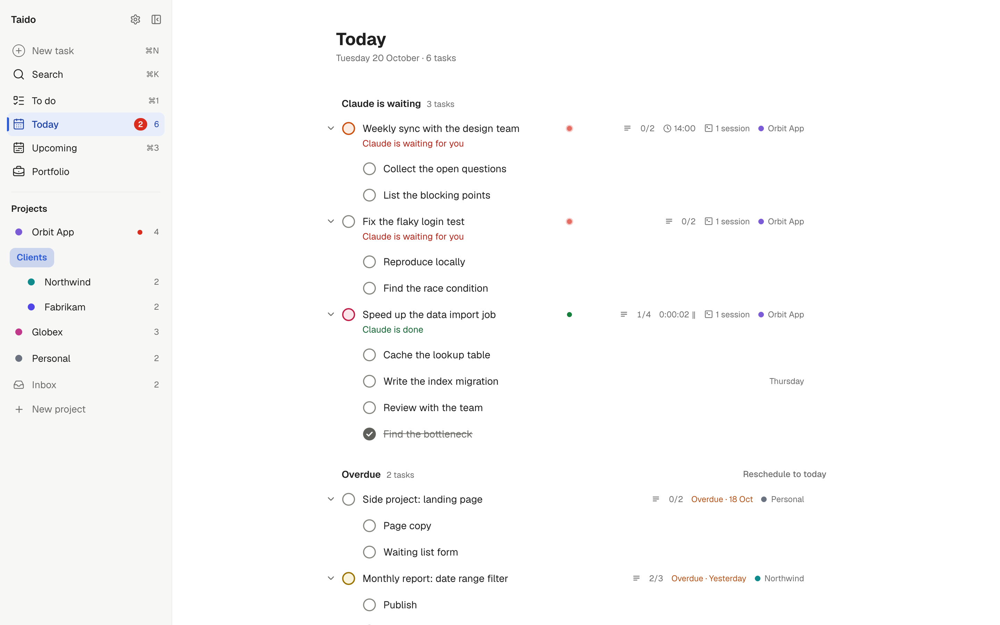
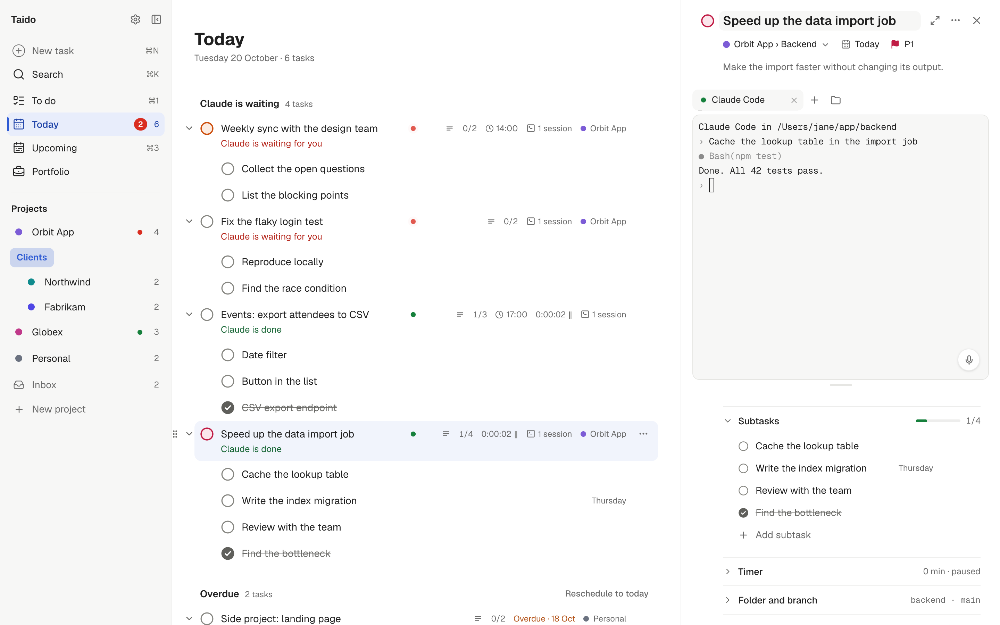
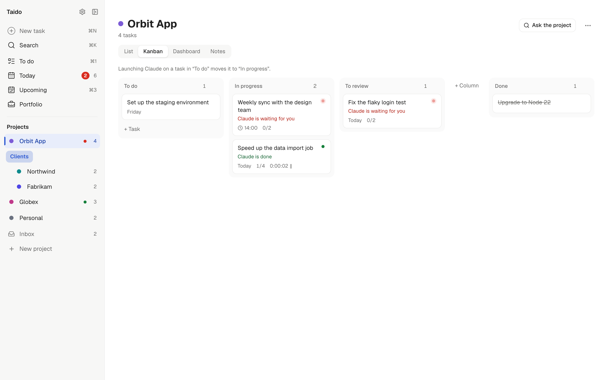
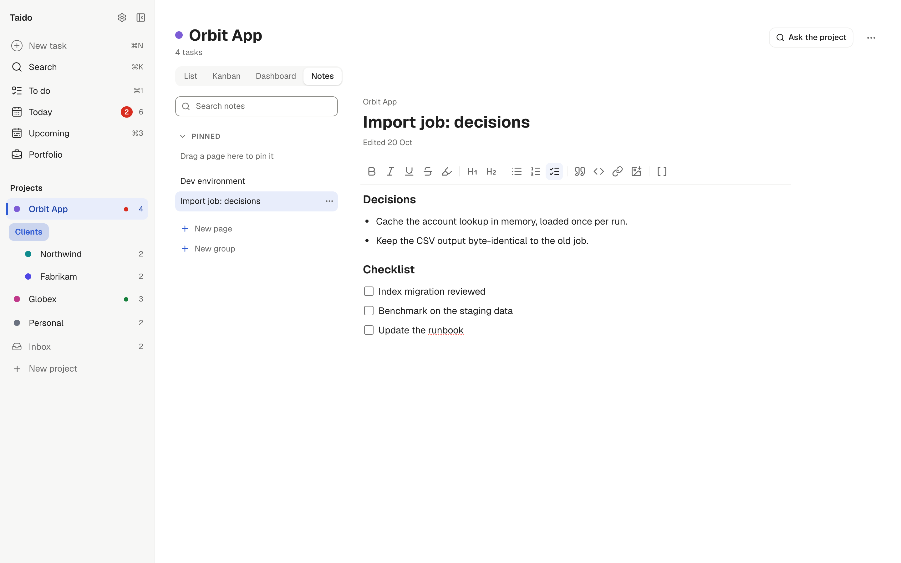

<p align="center">
  
</p>

<h1 align="center">Taido</h1>

<p align="center">
  A to-do app where every task is a workspace for Claude Code and Codex.
</p>

https://github.com/user-attachments/assets/a501dc60-132a-4089-8cfc-81d7e00cefab

Taido is for people who work with Claude Code or Codex on several tasks at once. Each task owns its terminals, its notes and its time. A status ring on every task tells you which agent is working, which one is waiting for you and which one is done, so you stop switching windows to find out.

Everything stays on your computer. No account, no cloud, no telemetry.



## Screenshots

| A task with its terminal | Kanban board |
| --- | --- |
|  |  |



## Features

- **Tasks as workspaces.** Open a task and launch Claude Code, Codex, a shell or any command in its own folder.
- **Status ring.** Each task shows what its agent is doing: working, waiting for you (permission or question), done, or failed. It is driven by the agent's own hooks, not by guessing from terminal output.
- **Claude Code and Codex terminals.** Several terminals per task, resumable sessions, a history of past conversations.
- **Notebook.** Notes per project, with pages, groups and links between pages and tasks. Agents can write to it too.
- **Timer and time export.** Track time on a task and export it as CSV.
- **Today, Upcoming and Kanban.** A to-do list in the Todoist style, a calendar, and a board per project.
- **Phone app.** Optional. Sync with your own server and use the same app on your phone (see [docs/SELF-HOSTING.md](docs/SELF-HOSTING.md)).
- **English and French.**
- **Local first.** Data lives in a SQLite file on your machine. No account needed.

## Download

Get the latest build from the [Releases page](https://github.com/Shyhnz/taido/releases).

- **macOS:** download `Taido_<version>_universal.dmg`, open it and drag Taido to Applications.
- **Windows:** build coming soon (in testing).

### First launch on macOS

The app is not notarized by Apple yet, so macOS asks for confirmation the first time.

1. Open Taido from Applications. macOS says it cannot verify the app. Click **Done**.
2. Open **System Settings > Privacy & Security**, scroll down and click **Open Anyway** next to Taido.
3. Confirm with your password. The app opens, and it will not ask again.

## Requirements

Taido drives Claude Code and Codex, it does not replace them. Install at least one and log in:

- [Claude Code](https://docs.claude.com/en/docs/claude-code/overview)
- [Codex](https://github.com/openai/codex)

Without them you still get tasks, notes, timer and shell terminals.

## Sync and phone

Sync is optional and runs on a server you own. The sync server and the phone app are in this repository. See [docs/SELF-HOSTING.md](docs/SELF-HOSTING.md) for Docker and manual setup. A hosted option is coming soon.

## Build from source

You need [Node.js](https://nodejs.org), [pnpm](https://pnpm.io) and the [Rust toolchain](https://rustup.rs) (plus the [Tauri prerequisites](https://tauri.app/start/prerequisites/) for your system).

```sh
pnpm install
pnpm tauri dev     # run the app in development
pnpm check         # lint, type checks and all tests
pnpm tauri build   # build an installer
```

## Contributing

Issues and pull requests are welcome. Read [CONTRIBUTING.md](CONTRIBUTING.md) first. To report a security problem, see [SECURITY.md](SECURITY.md).

## Known limitations

- Windows support is in testing. No Windows build is published yet.
- Builds are not signed or notarized, so your system asks for confirmation on first launch.

## License

[AGPL-3.0-or-later](LICENSE). Copyright 2026 NUOPS. Made by Shyhn.
